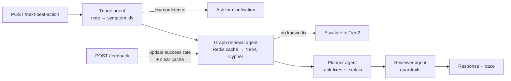
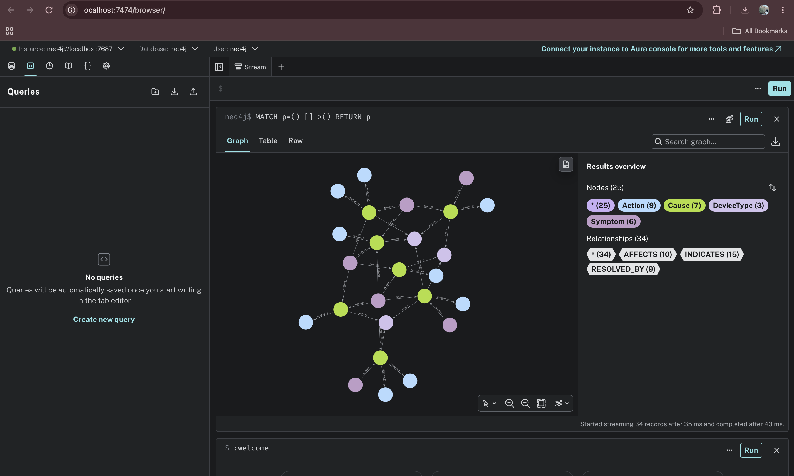

# Field Next-Best-Action Agent

A multi-agent service that tells a field technician what to do next. The tech sends a device type and a free-text note ("no internet, red LOS light on the ONT"). The service works out the symptoms, looks up likely causes and proven fixes in a **Neo4j knowledge graph**, ranks the fixes, and passes the answer through a guardrail before returning it. After the job, the tech reports whether the fix worked, and the graph **learns from that outcome**.

Built with **LangGraph**, **Neo4j**, **Redis**, **FastAPI**, and an optional **OpenAI** model. It runs fully offline with no API key.

> The knowledge graph uses **synthetic sample data** I wrote for this demo. It is not from any company's systems.

## How it works



| Agent | What it does |
|---|---|
| **Triage** | Maps the note to known symptom ids. Uses the LLM if `OPENAI_API_KEY` is set; otherwise keyword matching. LLM output is checked against the allowed ids, so it can't invent symptoms. |
| **Graph retrieval** | Checks Redis first, then runs one Cypher query: symptoms → causes that affect this device → actions that fix those causes. |
| **Planner** | Scores each action as `cause likelihood × fix rate ÷ (1 + minutes/120)`, so a quick fix can beat a slightly more reliable slow one. Returns the top pick, two alternates, and a short explanation. |
| **Reviewer** | Escalates fixes that need the network operations center and adds warnings when the score or symptom match is weak. |

Every node writes its name and run time to a `trace` list, so each response shows the path it took and where the time went.

### Learning from outcomes

After a job, the technician calls `POST /feedback` with the cause, the action, and whether it worked. The success rate on that `RESOLVED_BY` edge becomes `(starting rate × 10 + successes) ÷ (10 + attempts)`. The starting rate counts as 10 past jobs, so one bad report nudges it instead of wiping it out. The cache is cleared so the next answer uses the new rate.

Example: "Move to a cleaner Wi-Fi channel" starts at 70%. One failed report drops it to 64%, and the next router ticket recommends "Add a mesh extender" first.

### Graph model



```
(:Symptom)-[:INDICATES {weight}]->(:Cause)-[:AFFECTS]->(:DeviceType)
(:Cause)-[:RESOLVED_BY {success_rate, attempts, successes}]->(:Action)
```

The retrieval query (`app/graph_store.py`):

```cypher
MATCH (s:Symptom)-[i:INDICATES]->(c:Cause)-[:AFFECTS]->(:DeviceType {id: $device_type})
WHERE s.id IN $symptom_ids
WITH c, sum(i.weight) AS cause_score
MATCH (c)-[r:RESOLVED_BY]->(a:Action)
RETURN a.id AS action_id, a.name AS action, r.success_rate AS success_rate, cause_score, ...
ORDER BY cause_score * success_rate DESC, action_id
LIMIT $limit
```

## Run it

### Option 1: no setup (in-memory graph and cache)

```bash
python -m venv .venv && source .venv/bin/activate     # Windows: .venv\Scripts\activate
pip install -r requirements-dev.txt
pytest                                                # unit tests
python -m app.demo                                    # four example tickets
uvicorn app.api:create_app --factory --reload         # API at http://localhost:8000/docs
```

### Option 2: full stack with Docker (Neo4j + Redis + API)

```bash
cp .env.example .env          # optional: add OPENAI_API_KEY
docker compose up --build
```

- API docs: http://localhost:8000/docs
- Neo4j browser: http://localhost:7474 (user `neo4j`, password `localpassword`). Try `MATCH p=()-[]->() RETURN p`.

### Example

```bash
curl -X POST localhost:8000/next-best-action \
  -H "content-type: application/json" \
  -d '{"device_type": "router", "description": "Wi-Fi keeps dropping and speeds are slow"}'
```

```json
{
  "status": "ok",
  "symptoms": ["slow_speed", "wifi_drops"],
  "recommendation": {
    "action": "Move to a cleaner Wi-Fi channel",
    "cause": "Wi-Fi channel interference",
    "est_minutes": 10,
    "success_rate": 0.7,
    "score": 0.969
  },
  "alternatives": [{"action": "Add a mesh extender"}, {"action": "Restore a known-good router config"}],
  "explanation": "Most likely cause: Wi-Fi channel interference. Start with \"Move to a cleaner Wi-Fi channel\" ...",
  "cache_hit": false,
  "trace": [
    {"node": "triage_agent", "ms": 1.03},
    {"node": "graph_retrieval_agent", "ms": 7.04},
    {"node": "planner_agent", "ms": 0.01},
    {"node": "reviewer_agent", "ms": 0.0}
  ]
}
```

(Trimmed. The real response includes every field.)

Report that the fix didn't work:

```bash
curl -X POST localhost:8000/feedback \
  -H "content-type: application/json" \
  -d '{"cause_id": "wifi_interference", "action_id": "change_wifi_channel", "success": false}'
```

```json
{"cause_id": "wifi_interference", "action_id": "change_wifi_channel", "success_rate": 0.636, "attempts": 1, "successes": 0}
```

Send the same ticket again and the top pick becomes "Add a mesh extender".

## Endpoints

| Method | Path | Purpose |
|---|---|---|
| POST | `/next-best-action` | Main endpoint. `device_type` is one of `ont`, `router`, `small_cell`. |
| POST | `/feedback` | Report whether a fix worked. Updates that fix's success rate in the graph and clears the cache. |
| GET | `/health` | Shows which store, cache, and LLM mode are active. |
| GET | `/workflow` | The LangGraph workflow as a Mermaid diagram. |

## Tests and CI

- **Unit tests** cover triage, graph retrieval, every routing branch, the cache, the LLM path (with a fake model), LLM failure fallback, API validation, and the feedback loop (rate math, cache clearing, and the recommendation changing after a failed fix).
- **Integration tests** seed a real Neo4j instance and check that the Cypher queries return the same rankings and feedback updates as the in-memory store. A second test checks Redis TTL. They skip locally unless `NEO4J_URI` / `REDIS_TEST_URL` are set.
- **GitHub Actions** (`.github/workflows/ci.yml`) starts Neo4j and Redis as service containers, runs the full suite, and builds the Docker image. A `Jenkinsfile` with the same stages is included.

## Project layout

```
app/
  agents.py        the four agents + routing functions
  workflow.py      LangGraph StateGraph wiring
  graph_store.py   Neo4j store + in-memory twin (same interface), feedback updates
  cache.py         Redis cache + in-memory TTL cache
  llm.py           LLM prompts and offline fallbacks
  api.py           FastAPI app
  seed.py          loads sample data into Neo4j
  sample_data.py   synthetic graph
  demo.py          CLI demo
tests/
```

## Design choices

- **Graph instead of vector search.** Symptom → cause → fix is a chain of relationships with weights. A graph query returns the reasoning path, not just similar text, so every recommendation can be traced back to the edges that produced it.
- **The LLM is optional.** It improves triage on messy notes and writes nicer explanations, but the ranking comes from data, not from the model. With no key, everything still works.
- **Same interface, two backends.** `InMemoryGraphStore` and `Neo4jGraphStore` share one interface, so tests run in under a second and CI proves the two give the same results.
- **Smoothed learning.** Feedback uses the starting rate as a prior worth 10 jobs, so early reports can't swing a fix to 0% or 100%. The seed script uses `ON CREATE SET`, so restarting the app doesn't wipe learned rates.

## Next steps

- Add LangGraph checkpointing so a tech can answer the clarification question and resume the same run
- Add Prometheus metrics for per-node latency and escalation rate
- Add a Docker volume so learned rates in Neo4j survive `docker compose down`